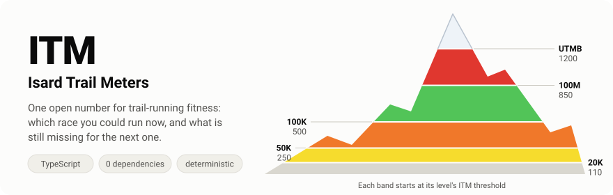
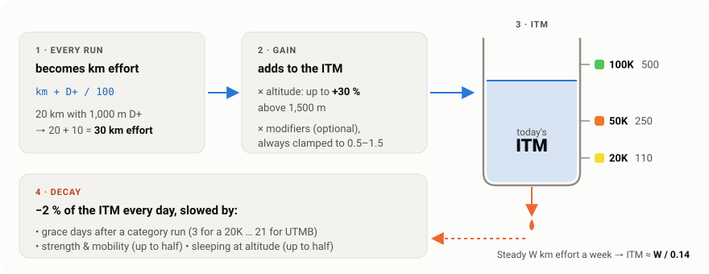
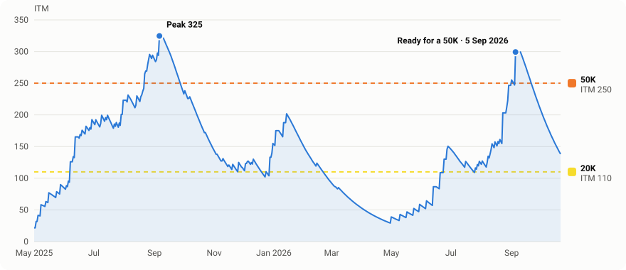
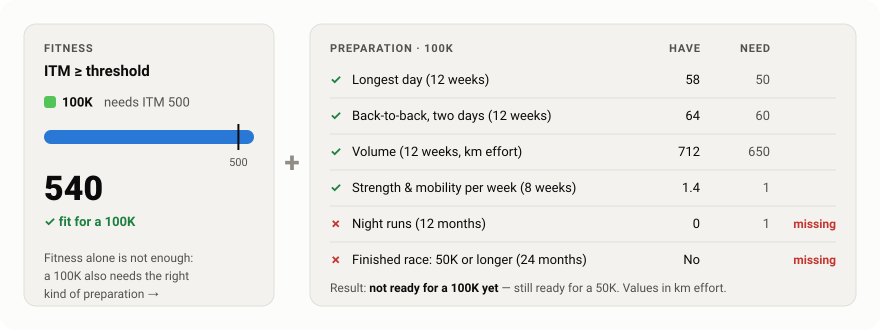
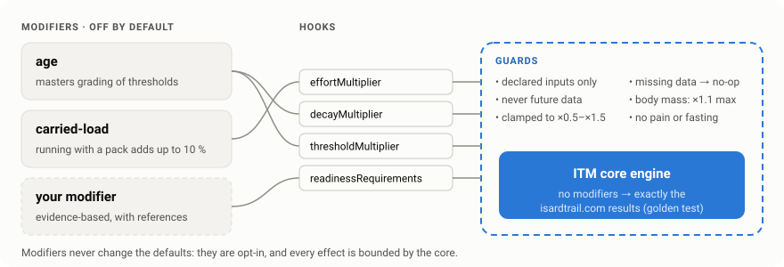

<p align="center">
  
</p>

<p align="center">
  <b>A free, open-source measure of trail-running fitness.</b><br>
  ITM turns your runs into one number that tells you which race category you could run <i>now</i> — 20K, 50K, 100K,
  100M or UTMB — and what is still missing to be ready for it.
</p>

---

- It **rises** with what you run (distance and climbing), more for long runs and runs at altitude.
- It **fades** every day you don't train, a little slower if you keep doing strength and mobility, or sleep high.
- Being **ready** for a category takes fitness _and_ the right preparation: long runs, back-to-backs, volume, night
  runs, nights out and a previous race.
- It is **deterministic and causal**: the value on a day only depends on what happened up to that day.
- It is **strictly typed**: dates, race categories, levels and modifier params are checked by the compiler, and every
  input that can come from untrusted JavaScript or JSON is validated at runtime too.

ITM was created for [isardtrail.com](https://isardtrail.com) and is now a standalone TypeScript package. The community
can extend it with new, evidence-based variables (age, carried load, heat, HRV…) through a typed
[modifier system](docs/MODIFIERS.md) — without ever changing the default results. The exact formulas are in
[docs/SPEC.md](docs/SPEC.md).

## Contents

- [How it works](#how-it-works) · [A real season](#a-real-season) · [Fitness is not readiness](#fitness-is-not-readiness)
- [Install](#install) · [Usage](#usage) · [Types](#types) · [Configuration](#configuration)
- [Modifiers](#modifiers-community-variables) · [Privacy](#privacy) · [Parity](#parity-with-isardtrailcom) ·
  [Development](#development)

## How it works

<p align="center">
  
</p>

ITM is a **leaky bucket measured in km effort**, the unit mountain races use to compare courses (every 100 m of climbing
counts as 1 km):

1. **Every run becomes km effort.** 20 km with 1,000 m D+ is 30 km effort.
2. **Its effort is added to the ITM**, up to 30 % more when run above 1,500 m.
3. **The level follows the ITM.** Each race category has a threshold; you reach a level at its threshold and only lose
   it below 80 % of it (the cushion), so one quiet week does not take a category away.
4. **Every day the ITM leaks 2 %** — except for a few grace days after a run of a category (3 after a 20K run, 21 after
   a UTMB-sized one). Strength and mobility sessions and nights slept at altitude slow the leak, never fill it.

The leak makes the number honest: training **W** km effort every week settles ITM at about **W / (7 × 2 %)**, so each
level has a weekly volume that holds it.

| Level   | ITM threshold | One run of this category | Weekly km effort that holds it |
| ------- | ------------: | -----------------------: | -----------------------------: |
| 🟨 20K  |           110 |              ≥ 20 effort |                             15 |
| 🟧 50K  |           250 |              ≥ 45 effort |                             35 |
| 🟩 100K |           500 |              ≥ 75 effort |                             70 |
| 🟥 100M |           850 |             ≥ 155 effort |                            119 |
| ⬜️ UTMB |          1200 |             ≥ 278 effort |                            168 |

Colours are the official UTMB category colours. Every number above is a default of `ItmConfig` and can be changed.

## A real season

<p align="center">
  
</p>

This chart is not a mock-up: it is `simulateItm` run on the real Strava history the defaults were calibrated on
(`test/history.fixture.ts`), drawn by [`scripts/readme-chart.ts`](scripts/readme-chart.ts) (`npm run docs:chart`).
Summer blocks of long mountain runs push ITM over the 50K threshold, the winter lets it fade, and the build-up in
2026 makes the athlete ready for a 50K on 5 September 2026 — the day they wrote "we're ready for the marathon", a few
weeks before the race. The calibration test checks exactly that.

## Fitness is not readiness

<p align="center">
  
</p>

ITM says how fit you are. **Ready** for a category means ITM at its threshold _and_ the preparation that category
demands, evaluated at a date (the past never changes):

| Requirement                               | 20K | 50K | 100K |  100M |  UTMB |
| ----------------------------------------- | --: | --: | ---: | ----: | ----: |
| Longest day, last 12 weeks (km effort)    |  15 |  30 |   50 |    70 |    90 |
| Back-to-back, two days (km effort)        |   – |   – |   60 |    90 |   110 |
| Volume, last 12 weeks (km effort)         | 150 | 350 |  650 |   950 |  1200 |
| Night runs, last 12 months                |   – |   – |    1 |     2 |     2 |
| Nights out (bivouac, hut), last 12 months |   – |   – |    – |     1 |     1 |
| Strength & mobility per week (8 weeks)    |   – |   – |    1 |   1.5 |     2 |
| Finished race in the last 24 months       |   – |   – | 50K+ | 100K+ | 100K+ |

`readinessFor` returns every requirement with what you have and what you need, so an app can show what is missing.

## Install

Straight from GitHub (no npm publish needed; `prepare` builds `dist/` on install):

```sh
npm install github:isardmart/itm-index-trail-running
```

Pure TypeScript, **zero runtime dependencies**, ESM + CommonJS with type declarations. Node ≥ 20 and modern browsers.

## Usage

```ts
import { createItm, type ItmActivity, type ReadinessInput } from "@isardtrail/itm";

const activities: ItmActivity[] = [
  { date: "2026-06-02", type: "trail_run", distance_m: 16_000, elevation_gain_m: 600 },
  { date: "2026-06-06", type: "trail_run", distance_m: 32_000, elevation_gain_m: 1_800, altitude_m: 2_100 },
  { date: "2026-06-08", type: "strength", distance_m: null, elevation_gain_m: null },
];

const itm = createItm(); // defaults; createItm({ locale: "ca" }) for Catalan labels
const series = itm.simulateItm(activities, "2026-10-21", { baseline: { date: "2026-05-01", itm: 0 } });
const today = itm.itmOn(series, "2026-10-21");

const input: ReadinessInput = { sessions: [], supportWeeks: [], races: [] };
console.log(today, itm.readyFor("2026-10-21", today, input)?.label ?? "no category yet");
```

`fromStravaActivity` converts Strava summaries, and `isNightRun` / `sleptOutIds` derive night runs and nights out for
`ReadinessInput`. A runnable script is in [examples/](examples/print-series.mjs):

```sh
npm run build && node examples/print-series.mjs examples/activities.json
```

Every function is also exported standalone, taking the config as an argument: `simulateItm(activities, until,
{ baseline, stays, config, modifiers })`, `readinessFor(key, date, itm, input, { config })`, `kmEffort`, `itmEvents`,
`nextItmLevel`, `levels(config)`, `zones(config)`, `stravaAltitude`, `isNightRun`, `sleptOutIds`…

## Types

The package is written in strict TypeScript (`strict`, `noUncheckedIndexedAccess`, `exactOptionalPropertyTypes`,
`typescript-eslint` `strictTypeChecked`) and ships its declarations. The type guarantees are themselves tested in
[`test/types.test-d.ts`](test/types.test-d.ts): every `@ts-expect-error` there is a mistake the compiler must reject.

### Dates

```ts
/** "YYYY-MM-DD", no time zone. A template literal type: "yesterday" or a Date does not compile. */
type DateOnly = `${number}-${number}-${number}`;

isDateOnly(value: unknown): value is DateOnly; // type guard, also checks the calendar (no 2026-02-30)
toDateOnly(value: string): DateOnly;           // same check, throws a RangeError
```

Literals just work. A `string` from JSON, a form or a database must be checked first — which is exactly when a bad
date would otherwise slip through:

```ts
itm.simulateItm(activities, "2026-10-21"); // ✓
itm.simulateItm(activities, req.query.until); // ✗ Argument of type 'string' is not assignable to … DateOnly
itm.simulateItm(activities, toDateOnly(req.query.until)); // ✓ validated
```

### Inputs

```ts
type ActivityType = "run" | "trail_run" | "hike" | "strength" | "swim" | "mobility" | "rest" | "other";

type ItmActivity = {
  date: DateOnly;
  type: ActivityType;
  distance_m: number | null;
  elevation_gain_m: number | null;
  altitude_m?: number | null; // (elev_high + elev_low) / 2 from Strava, see stravaAltitude
  carriedLoadKg?: number | null; // modifiers only
  temperatureC?: number | null; // modifiers only
};

type ItmBaseline = { date: DateOnly; itm: number }; // when the athlete started, and their ITM then
type AltitudeStay = { start: DateOnly; end: DateOnly; altitude_m: number }; // nights slept at altitude

type ReadinessInput = {
  sessions: { date: DateOnly; effort: number; night: boolean; sleptOut: boolean }[]; // running sessions
  supportWeeks: { week: DateOnly; count: number }[]; // strength + mobility sessions per Monday-week
  races: { date: DateOnly; key: ItmKey }[]; // finished races and their category
};
```

### Outputs

```ts
const ITM_KEYS = ["20k", "50k", "100k", "100m", "utmb"] as const;
type ItmKey = (typeof ITM_KEYS)[number]; // "20k" | "50k" | "100k" | "100m" | "utmb"
type LevelIndex = 0 | 1 | 2 | 3 | 4 | 5; // 0 = no level yet, 1 = 20K … 5 = UTMB

type ItmDay = {
  date: DateOnly;
  itm: number; // end of day, 2 decimals
  level: LevelIndex;
  gain: number; // added by the day's sessions
  decay: number; // lost that day, 2 decimals
};

type ItmLevel = {
  key: ItmKey;
  label: string;
  color: string;
  threshold: number;
  minEffort: number;
  grace: number;
  weekly: number;
};
type ItmEvent = { day: DateOnly; kind: "session" | "decay" | "level"; delta: number; label: string };

type Requirement = { key: RequirementKey; label: string; have: string; need: string; ok: boolean };
type Readiness = { level: ItmLevel; ready: boolean; requirements: Requirement[] };
```

### The bound instance

`createItm(options)` returns a frozen `Itm`. Its config and lists are read-only, and its functions are plain arrow
functions, so destructuring them is safe:

```ts
type CreateItmOptions = {
  config?: Readonly<ItmConfig>; // full config, validated (default DEFAULT_ITM_CONFIG)
  patch?: ItmConfigPatch | null; // partial changes on top of config
  locale?: "en" | "ca" | ItmLocale;
  modifiers?: readonly ModifierUse[]; // all off unless listed
  athlete?: AthleteProfile; // local-only data for the modifiers
};

const { simulateItm, readinessFor, readyFor } = createItm({ locale: "ca" });
```

### Modifiers

```ts
type ModifierHooks<P> = {
  effortMultiplier?(this: void, activity: Readonly<ItmActivity>, athlete: AthleteView, day: DayContext, params: Readonly<P>): number;
  decayMultiplier?(this: void, day: DayContext, athlete: AthleteView, state: ItmStateView, params: Readonly<P>): number;
  thresholdMultiplier?(this: void, levelKey: ItmKey, athlete: AthleteView, params: Readonly<P>): number;
  readinessRequirements?(this: void, levelKey: ItmKey, athlete: AthleteView, context: ReadinessHookContext, params: Readonly<P>): ReadinessAdjustment | null | undefined;
};

defineModifier<P>(m: ItmModifier<P>): ItmModifier<P>; // hooks receive params typed as P
withParams<P>(m: ItmModifier<P>, params: Partial<P>): ModifierUse; // overrides checked against P

validateModifier(value: unknown): string[]; // for plain-JS modifiers: every field checked at runtime
validateAthleteProfile(value: unknown): string[];
```

```ts
withParams(ageModifier, { mastersFrom: 40 }); // ✓
withParams(ageModifier, { masterFrom: 40 }); // ✗ 'masterFrom' does not exist… Did you mean 'mastersFrom'?
```

All types are exported from the package root: `import type { ItmDay, ItmKey, … } from "@isardtrail/itm"`.

## Configuration

All numbers live in one plain `ItmConfig` object. The defaults (`DEFAULT_ITM_CONFIG`, deeply frozen) are the
calibrated ones and give exactly the isardtrail.com results.

```ts
import { createItm, diffFromDefault, mergeItmConfig, validateItmConfig, DEFAULT_ITM_CONFIG } from "@isardtrail/itm";

const itm = createItm({ patch: { altitudeFrom: 1000, levels: { "50k": { threshold: 260 } } } });
const custom = mergeItmConfig(DEFAULT_ITM_CONFIG, { decay: 0.025 });
validateItmConfig(custom); // [] when valid
diffFromDefault(custom); // { decay: 0.025 } — what to store
```

There is no global state: the config is always an explicit argument, and two `createItm` instances never affect each
other. Invalid configs throw `ItmConfigError`.

## Modifiers (community variables)

<p align="center">
  
</p>

Modifiers add optional variables to ITM. They are **all off by default**, do nothing when their data is missing, and
the core clamps every effect.

```ts
import { ageModifier, carriedLoadModifier, createItm, withParams } from "@isardtrail/itm";

const itm = createItm({
  modifiers: [ageModifier, withParams(carriedLoadModifier, { maxBonus: 0.05 })],
  athlete: { birthDate: "1975-03-14", bodyMassKg: 68 }, // all optional, local only
});
```

| Modifier       | Status   | What it does                                                          |
| -------------- | -------- | --------------------------------------------------------------------- |
| `altitude`     | core     | Runs at altitude add more; sleeping high slows decay (in `ItmConfig`) |
| `age`          | builtin  | Masters age grading of thresholds, slightly faster decay              |
| `carried-load` | builtin  | Runs with a pack add up to 10 % more                                  |
| `heat`, `hrv`  | proposal | Documented templates waiting for evidence                             |

Writing one: [docs/MODIFIERS.md](docs/MODIFIERS.md) and the type-checked template in
[examples/custom-modifier.ts](examples/custom-modifier.ts). Proposing one: [CONTRIBUTING.md](CONTRIBUTING.md).

Hard rules, enforced in code and tests: every multiplier is clamped to [0.5, 1.5]; modifiers cannot see future data;
ITM never rewards pain, injury, fasting or weight loss; body mass may only normalise effort (carried load), only ever
sees the highest value known so far, and is capped at +10 %.

## Privacy

- The core only needs running activities. It never needs personal or health data.
- The package does **no I/O and no network**: nothing is ever sent anywhere. Athlete data passed to modifiers stays in
  your process's memory.
- Every personal variable is optional, and an ITM can always be computed without it.
- Night-out detection reads titles, descriptions and coordinates only to return yes/no; publish the result, not the
  inputs.

## Parity with isardtrail.com

`test/golden.test.ts` runs the original website engine (a frozen copy in `test/reference/`) and this package side by
side on the real calibration history and on hundreds of seeded random histories, for the default config, the live
site config and random configs. With defaults and no modifiers the outputs are identical: series (`itm`, `decay`,
`level`, `gain`), events and readiness. Any change to default outputs is a **major** version.

## Development

```sh
npm install
npm run check      # lint, typecheck, format, tests (incl. type tests) with coverage, build
npm run smoke      # installs the package from git into an empty folder and uses it (ESM + CJS)
npm run docs:chart # redraws docs/assets/itm-history.svg from the engine
```

## Credits and licence

Created by **Isard Trail** ([isardtrail.com](https://isardtrail.com)). MIT licence — see [LICENSE](LICENSE).
